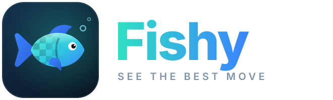
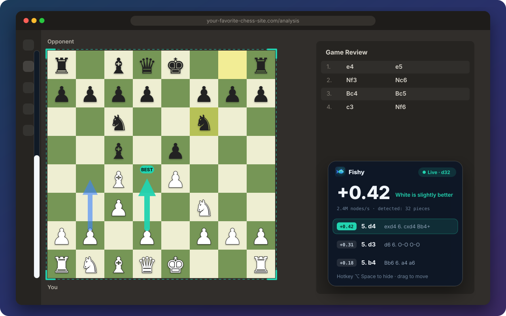

<div align="center">

  

  <h3>See the best move, as it happens.</h3>

  A beautiful screen overlay that shows live engine analysis on any chess board,
  for training and learning. Powered by Stockfish.
  <br>
  <strong>macOS · Windows</strong>
  <br>
  <br>
  [Roadmap](docs/ROADMAP.md)
  ·
  [Architecture](app/docs/ARCHITECTURE.md)
  ·
  [Contributing](CONTRIBUTING.md)
  ·
  [Report a bug](https://github.com/realwuji/fishy-overlay/issues/new)

  
  
  

</div>

<p align="center">
  
  <br>
  <sub><i>Design concept: Fishy draws live analysis over the board in any app or website.</i></sub>
</p>

> **Heavily inspired by Stockfish.** Fishy started life as a fork of the
> [Stockfish](https://github.com/official-stockfish/Stockfish) repository and is
> heavily inspired by it: from its UCI engine, which does all the thinking, to
> its README structure, contribution guide and open-source spirit. Huge thanks
> to the Stockfish developers and community.

## Our goal

Chess engines are incredibly strong, but they speak in numbers and move lists
that are hard for learners to read. **Fishy turns the engine into a teacher.**

Fishy is **not another chess app**. It is a lightweight overlay that runs on top
of your screen and watches the board in whatever app, browser or website you
already like. It reads the position, asks [Stockfish][website-link] what it
thinks, and draws the answer right on your board: best-move arrows, an
evaluation bar and short explanations. No new site, no new account, no copying
moves by hand.

## How it works

```
 Screen capture  ->  Board detection  ->  Position (FEN)  ->  Stockfish  ->  Overlay
 (your browser or    (find the 8x8 grid,   (pieces, side to    (best moves,    (arrows and HUD
  chess app)          recognise pieces)      move, orientation)  evaluation)     drawn over it)
```

  1. **See.** Fishy captures the window or screen region you choose, using the
     native capture APIs of your system.
  2. **Understand.** Computer vision locates the board and recognises every
     piece, including when you flip the board or change the theme.
  3. **Think.** The position is sent to a bundled Stockfish that runs locally.
  4. **Show.** A transparent, click-through overlay lines up with the board and
     draws arrows and an evaluation bar. A small floating panel lists the top
     lines with plain-language explanations.

## Vision

  * **Works with what you already use.** chess.com, Lichess, desktop apps,
    video lessons, PDF books or a board on a streamed lecture. If a board is on
    your screen, Fishy can read it.

  * **Live move guidance.** Arrows and the evaluation update in real time as
    the engine searches deeper.

  * **Built for training and education.** Candidate moves, threats and
    plain-language explanations make positions easy to understand for beginners
    and coaches alike.

  * **Beautiful, calm interface.** A polished overlay with smooth animations,
    light and dark themes and nothing in the way of the board.

  * **macOS and Windows.** One experience on both platforms, with a simple
    installer and no engine setup required.

  * **Private and offline.** Screen contents are processed on your computer and
    never uploaded.

## Planned features

| Area | What you will get |
|------|-------------------|
| Overlay | Transparent, always-on-top, click-through arrows and eval bar aligned to the real board |
| Detection | Automatic board and piece recognition, any theme, either orientation |
| Live analysis | Best-move arrows, multi-line (MultiPV) candidates, depth and speed readout |
| Explanations | Short plain-language reasons for the top move |
| Learning aids | Highlight hanging pieces, threats and key squares |
| Controls | Global hotkeys, draggable panel, capture-region picker, multi-monitor |
| Review | Studying finished games, puzzles, lessons and books on screen |

Fishy is in early development. The foundation works end to end on macOS (engine
driver, move classification and tactic tags, chess.com board detection, overlay
and control window, all with tests). Wider real-world tuning and Windows testing
come next. See the [roadmap](docs/ROADMAP.md).

## Fair play and intended use

**Fishy is a learning and analysis tool. Do not use it to get help during a
live game against another person.** Using an engine in rated or casual games
against humans is cheating, it breaks the rules of every chess site, and
accounts that do it get banned. Fishy is meant for:

  * studying and reviewing finished games,
  * solving puzzles and exercises,
  * playing against bots or in practice and analysis modes,
  * following lessons, lectures and books,
  * coaching and teaching.

The authors do not support or accept responsibility for misuse.

## Tech stack

| Layer | Choice | Why |
|-------|--------|-----|
| Desktop shell | [Tauri 2](https://tauri.app) | Small, fast, native; supports transparent always-on-top click-through windows |
| Screen capture | ScreenCaptureKit (macOS), Windows Graphics Capture | Native, GPU-friendly, low CPU use |
| Vision | Rust + lightweight on-device model | Board and piece recognition at several frames per second |
| Overlay UI | TypeScript + modern web UI | GPU-accelerated animations at your display's refresh rate |
| Engine | Stockfish (this repo, `src/`) | World-class strength, bundled per platform and run as a sidecar |

macOS asks for the Screen Recording permission on first launch. Tauri uses
WebKit on macOS and WebView2 on Windows, so we test every release on both.

## Run it from source

You need Node 20+, a stable Rust toolchain and a C++ compiler (Xcode command
line tools on macOS, MSVC or MinGW on Windows). Stockfish is included as a
pinned git submodule.

```
git clone --recurse-submodules https://github.com/realwuji/fishy-overlay.git
cd fishy-overlay/app
npm install
scripts/build-stockfish.sh   # builds the bundled engine (downloads its network)
npm run tauri dev
```

See [app/README.md](app/README.md) for permissions, packaging and signing, and
[app/docs/ARCHITECTURE.md](app/docs/ARCHITECTURE.md) for how it all fits together.

## What is in this repository

  * [app](app), the Fishy desktop app (Tauri 2: Rust core, TypeScript UI).

  * [engine/stockfish](engine/stockfish), the official Stockfish source as a
    submodule, pinned to the exact commit Fishy is built and tested against.

  * [assets](assets), the Fishy logo, wordmark and overlay concept.

  * [docs](docs), the roadmap.

## Contributing

Ideas, designs, bug reports and code are welcome. See [CONTRIBUTING.md](CONTRIBUTING.md).
Improvements to the chess engine itself belong upstream in
[Stockfish](https://github.com/official-stockfish/Stockfish).

## License

Fishy is free software under the [GNU General Public License v3](LICENSE) (or
later). It bundles Stockfish, which is also GPLv3. Whenever you distribute a
build you must include the licence and the corresponding source code (this
repository and the pinned Stockfish submodule).

## Acknowledgements

Fishy is heavily inspired by, and built on, [Stockfish](https://stockfishchess.org),
created by the Stockfish developers and community (see its
[AUTHORS](https://github.com/official-stockfish/Stockfish/blob/master/AUTHORS)).
Stockfish uses neural networks trained on [data provided by the Leela Chess Zero
project](https://storage.lczero.org/files/training_data), made available under the
[Open Database License](https://opendatacommons.org/licenses/odbl/odbl-10.txt) (ODbL).

Fishy is not affiliated with or endorsed by the Stockfish project, chess.com or
Lichess. Chess.com and Lichess are trademarks of their respective owners.
